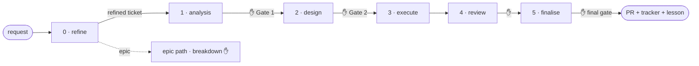

# mango-plugins


[](https://github.com/cuongdinhngo/mango-plugins/actions/workflows/validate.yml)

**mango** is a gated ticket workflow for Claude Code; this repo is the **marketplace** that hosts it
([`plugins/mango`](./plugins/mango)). Instead of letting an AI coding agent decide a ticket is "done",
mango forces every ticket through explicit review gates, produces evidence at each stage, and waits
for your approval before continuing.

> **Review evidence, not confidence.**

## Why mango?

AI coding agents are excellent at writing code, and much less reliable at deciding whether the work
is complete: a ticket gets marked "done" while an acceptance criterion was skipped, a test proves the
wrong thing, an edge case was never considered, documentation wasn't updated, or hidden assumptions
remain. mango routes every ticket through **gated phases** that each produce **checkable artifacts**
before the next can begin. You approve a diff on evidence, not vibes. Silence is never approval.

- ✅ A **requirements matrix** with explicit counts — nothing slips through unnamed
- ✅ A **proving test at the right layer** — a runtime requirement can't be closed by a unit-mock proof
- ✅ An independent **challenger** that never sees the work — it flags what the diff leaves unmet
- ✅ **Human approval gates** before every important transition
- ✅ A **PR + tracker update + durable lesson**, each behind explicit per-action approval

## Try it in 2 minutes

```
/plugin marketplace add cuongdinhngo/mango-plugins
/plugin install mango@mango-plugins
/mango:challenge path/to/ticket.md main..your-branch
```

No setup, no config, nothing written: point the ticket-blind challenger at a branch you already have.
It rebuilds the requirements from the ticket alone and marks each one met / not met / can't tell,
with a `path:line`, then a one-line summary. Advisory only — the full gated workflow starts at *Quick
start* below, and adds the counted matrix and per-row coverage shown in the
[plugin README](./plugins/mango/README.md#what-the-artifacts-look-like). The shape (fields vary):

```
1. AC-3  password reset invalidates the old token   met        src/auth/reset.ts:88
2. R-5   audit log entry written on failure         met        src/audit/log.ts:22
3. AC-4  rate limit applies to the reset endpoint   not met    —

14 requirements: 13 met, 1 not met, 0 can't tell
```

## Quick start

Needs git, Python 3.7+, a test command, and a tracker or local mode ([prerequisites](./plugins/mango/README.md#prerequisites)):

```
/mango:init          # detect your stack, write .harness.json, scaffold a starter rule book
/mango:doctor        # health-check the setup (✅/⚠/❌ with remediation)
/mango:solve PROJ-123
```

`init` marks every inferred value `UNVERIFIED` for you to confirm and writes **no secrets**. To fill it
by hand, copy `<plugin>/config/harness.minimal.json` to `.harness.json`, replace each `REPLACE_ME`,
create `tickets_dir`, and create the rule book file at `rulebook_path` — an empty file is enough to
start (`doctor` warns it is a stub; it does not fail). Every other key is in `harness.example.json`.
No rule book yet? [`/mango:codify`](./plugins/mango/README.md#getting-set-up) counts your conventions
and asks **you** to choose each standard. Rolling out to a team: [`docs/ADOPTION.md`](./docs/ADOPTION.md).

## The lifecycle

Six phases per ticket, each ending at a ✋ you approve — plus a **Gate 0** for an ambiguous ticket.



| Phase | What it does |
|-------|--------------|
| **0 · refine** | Exposes the ticket's unresolved product decisions — resolves the *how* ones with a citation, asks you the *want* ones — then self-skips when the ticket is already clear. Never authors your intent. |
| **1 · analysis** | Decomposes every section into a counted requirements matrix, records a `BASELINE` for the existing test state, and gathers the Phase-1 evidence behind each row. |
| **2 · design** | The approach, the rejected alternatives, the smallest change-list traced to matrix rows, and a per-requirement verification plan whose layer-match — and, for an AC whose answer depends on the shape of real input, whose **fixture provenance** — is a hard gate. |
| **3 · execute** | Only the approved changes, on one branch, with the proving test — committed *before* review is dispatched. |
| **4 · review** | An independent, ticket-blind **challenger** rebuilds the requirements and judges the diff against them. |
| **5 · finalise** | PR draft, tracker update, and a durable lesson — one explicit approval per outward action. |

**Epics** take the epic path: `breakdown` into tickets, approved by you before any executes. **Run
it:** `/mango:solve <KEY>`, any phase directly, or `/mango:quick <KEY>` for the lite lane. Run it
unattended with `/mango:autorun` — no gate removed, no auto-merge. Details in the
[plugin README](./plugins/mango/README.md#unattended-runs--mangoautorun). Beyond the lifecycle: `init` ·
`doctor` · `codify` · `promote` · `version-check` · `budget`, the one-shot `challenge`, and opt-in maps
`sitemap` and `db-map` — the [plugin README](./plugins/mango/README.md) has what each produces.

## Maturity

**Every release is gated by `validate.py` and the dispatch-free script suites**, run in CI on every
push. **mango has no behavioural regression suite.** It has a per-skill smoke guard of 8 fixtures, run
when a skill is edited: it does **not** detect cross-skill regressions, and the `RETIRE:` counted line
is uncovered. Experimental behaviours: [`principles/maturity.md`](./plugins/mango/principles/maturity.md)
· detail: [`docs/MATURITY.md`](./docs/MATURITY.md) · cost: [`docs/COST.md`](./docs/COST.md).

## Update and pin

Every push to `main` ships; every version bump is tagged `v<version>` with a
[GitHub Release](https://github.com/cuongdinhngo/mango-plugins/releases) (from `v1.18.2`). Policy: [`docs/STABILITY.md`](./docs/STABILITY.md).

```
/plugin marketplace update mango-plugins                    # update to the latest
/plugin install mango@mango-plugins
/plugin marketplace add cuongdinhngo/mango-plugins#v1.19.2  # or pin a tag (current shown; any works)
```

## Contributing and license

[CONTRIBUTING.md](./CONTRIBUTING.md) — read *Skills are directive-only* before editing a skill. MIT — [LICENSE](./LICENSE).
